  
  
  
  

 

## About

I'm an **AI Engineer** who builds Generative AI products that hold up in production: RAG systems, LLM agents with tool use, document intelligence and automation pipelines. Under the AI work sits a solid engineering base in **Python, FastAPI and Next.js**, with services shipped on **Docker and AWS**.

- **Now:** looking for an AI Engineer or Automation Engineer role, and building *Pakistan Compass*, a travel app for 2-day trips to northern Pakistan (Expo + Supabase).
- **Focus:** retrieval quality (hybrid search, re-ranking, RAGAS evals), safe LLM tool use, and vision-language models for messy scanned documents.
- **Ask me about:** Text-to-SQL guardrails, LangGraph agents, OCR + VLM extraction, and scrapers that survive real-world sites.

 

## Featured work

  
  

  
  

 

## Experience

**Trainee Python Developer, AI & Automation** · Jiddat Labs · Remote · *Jun – Sep 2026* 
Built GenAI workflows (LLMs, LangChain, RAG) that turn unstructured documents into structured data, plus ETL pipelines and Selenium/Playwright scrapers feeding downstream models. Containerized and deployed the services on AWS EC2.

**Python Intern** · Jiddat Labs · *Mar – Jun 2026* 
Python data pipelines, REST API integrations and dataset preparation for ML training and evaluation.

**BS Computer Science** · COMSATS University Islamabad · *2026* · CGPA 3.7 / 4.0 
Certifications: NLP Specialization (DeepLearning.AI) · Google Project Management

 

## Toolkit

  

 

## GitHub activity

  
  

