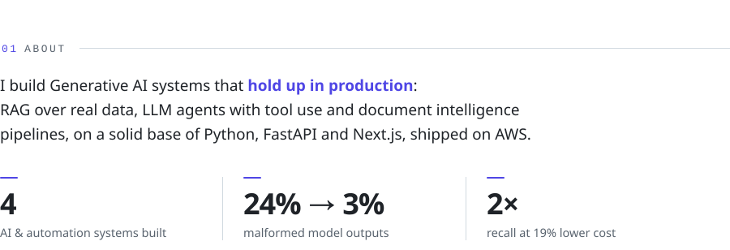
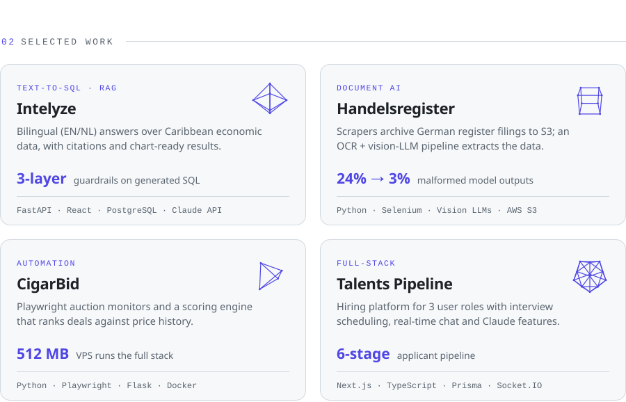
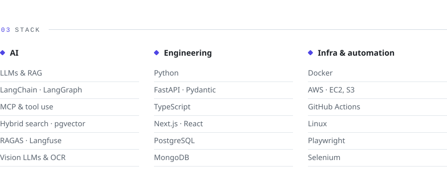
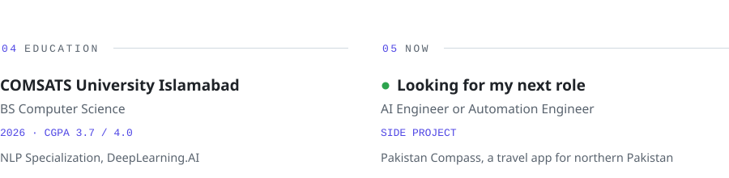
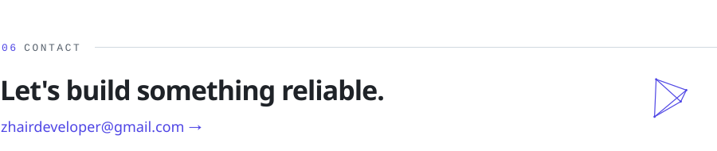

<picture>
  <source media="(prefers-color-scheme: dark)" srcset="./assets/header-dark.svg" />
  
</picture>

[LinkedIn](https://linkedin.com/in/zhair-ahmad) &nbsp;·&nbsp; [Email](mailto:zhairdeveloper@gmail.com) &nbsp;·&nbsp; [Behance](https://behance.net/zhair)

 

<picture>
  <source media="(prefers-color-scheme: dark)" srcset="./assets/about-dark.svg" />
  
</picture>

 

<picture>
  <source media="(prefers-color-scheme: dark)" srcset="./assets/work-dark.svg" />
  
</picture>

 

<picture>
  <source media="(prefers-color-scheme: dark)" srcset="./assets/stack-dark.svg" />
  
</picture>

 

<picture>
  <source media="(prefers-color-scheme: dark)" srcset="./assets/education-now-dark.svg" />
  
</picture>

 

<a href="mailto:zhairdeveloper@gmail.com">
<picture>
  <source media="(prefers-color-scheme: dark)" srcset="./assets/contact-dark.svg" />
  
</picture>
</a>
